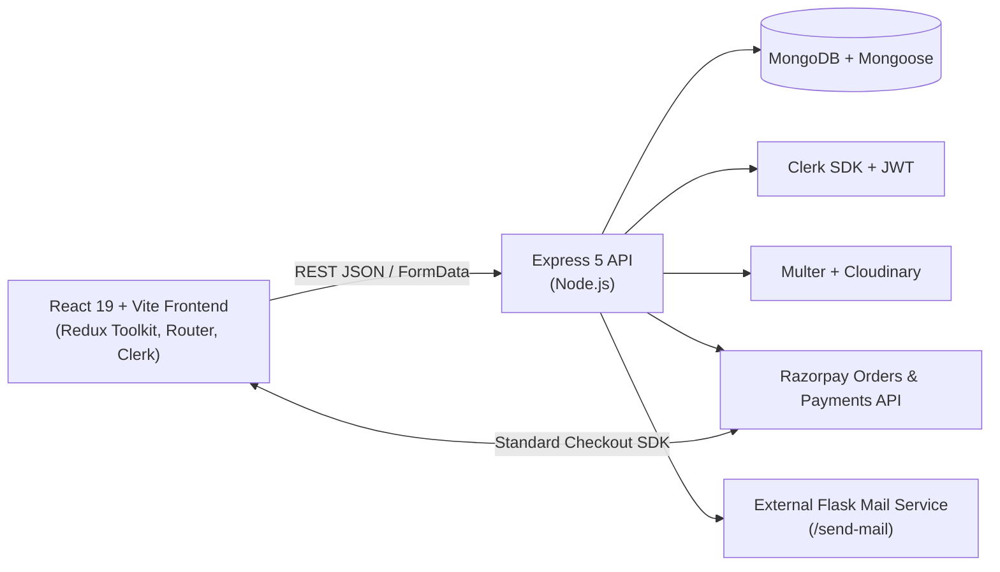

<div align="center">
  
  <h1>V E L O R A</h1>
  <p><em>Timeless luxury and artisanal craftsmanship for the discerning wardrobe.</em></p>

  <p>
    
    
    
    
    
    
    
  </p>

  <p>
    <a href="#highlights">Highlights</a> •
    <a href="#architecture">Architecture</a> •
    <a href="#tech-stack">Tech Stack</a> •
    <a href="#getting-started">Getting Started</a> •
    <a href="#environment-variables">Environment</a> •
    <a href="#api-reference">API Reference</a> •
    <a href="#-razorpay-test-payment">Razorpay Test Mode</a>
  </p>
</div>

---

## Overview

**Velora** is a full-stack luxury fashion e-commerce platform combining an editorial storefront with a dedicated **Admin Atelier Console**. Built with React 19, Redux Toolkit, Express 5, and MongoDB, it features INR (`₹`) catalog management, live inventory tracking, Cloudinary image uploads, server-verified **Razorpay** payments, Clerk/JWT customer authentication, and automated HTML email workflows via an external **Flask Mail Service**.

---

## Highlights

### Client Storefront
- **Editorial Browsing & Discovery**: Shop by curated department, category slug filtering (`/shop?category=...`), search query, and sorting (`featured`, price ascending/descending, alphabetical).
- **Live Inventory & Persistent Bag**: Real-time product stock guards across product detail pages, persistent customer carts, and checkout.
- **Wishlist & Address Book**: Save favorite garments, manage multiple shipping addresses, and select a default delivery destination.
- **Verified Customer Reviews**: ObjectId-linked product reviews with live published rating averages, plus immediate `Pending` visibility for the submitting author.
- **INR Shipping & Razorpay Checkout**: Complimentary standard delivery and priority air shipping (`₹250`, complimentary at `₹4,000+`), checked out through Razorpay Standard Checkout (`UPI`, `Cards`, `NetBanking`, `Wallets`) with recovery support if post-payment confirmation is interrupted.
- **Velora Circle & Concierge**: Newsletter subscription in the footer and homepage plus a live Contact Us concierge inquiry desk.

### Admin Atelier Console (`/admin`)
- **Environment-Governed Multi-Admin Auth**: Single or comma-separated `ADMIN_EMAIL` and `ADMIN_PASSWORD` credentials configured strictly in `backend/.env` with JWT cookie/bearer sessions and editable admin profiles.
- **Inventory & Media Uploads**: Create and edit products and categories using either external URLs or local file uploads powered by Multer and Cloudinary (with local `/uploads` fallback).
- **Stock & Fulfillment Control**: Inline product stock adjustment steppers, order filtering and status transitions (`In Preparation`, `Shipped`, `Delivered`, `Cancelled`), and one-click order receipt email resending.
- **Storefront Customization & Moderation**: Update the homepage Hero banner image, editorial headlines, and Philosophy artwork from `/admin/storefront`, and approve, hide, or delete client reviews from `/admin/reviews`.

### Automated Mail Workflows
Powered by the connected Flask Mail Service (`POST /send-mail`):
- **Welcome Email**: Sent upon new local registration or first verified Clerk customer creation.
- **Newsletter Confirmation**: Sent when visitors join via Footer or Velora Circle.
- **Order Confirmation & Admin Alert**: Sends itemized INR receipts with Razorpay reference IDs to customers and dispatch alerts to configured admins upon payment verification.
- **Fulfillment Status Updates**: Automatically emails customers when admins advance or cancel an order status.
- **New Arrival Broadcasts**: Notifies `Newsletter` subscribers and opted-in customers (`newsletterOptIn: true`) in throttled batches whenever a new product is published.
- **Concierge Inquiries**: Routes Contact Us messages to admin/concierge inboxes and sends an acknowledgment receipt to the sender.

---

## Architecture



---

## Getting Started

### Prerequisites
- **Node.js** `v18+` (for native `fetch` and `AbortSignal.timeout`)
- **MongoDB** running locally or via MongoDB Atlas
- Accounts / keys for **Clerk**, **Cloudinary** (optional for local upload fallback), and **Razorpay**

### 1. Install Dependencies

```bash
# Backend
cd backend
npm install

# Frontend (in a separate terminal)
cd frontend
npm install
```

### 2. Configure Environment Variables

Create `.env` files inside both `backend/` and `frontend/` using the provided samples:
- `backend/.env` (from [`backend/.env.sample`](./backend/.env.sample))
- `frontend/.env` (from [`frontend/.env.example`](./frontend/.env.example))

### 3. Run Development Servers

```bash
# Terminal 1 — Start Express API (default: http://localhost:8000)
cd backend
npm run dev

# Terminal 2 — Start Vite Dev Server (default: http://localhost:5173)
cd frontend
npm run dev
```

### Build & Lint Checks

```bash
cd frontend
npm run lint
npm run build
```

---

## Environment Variables

### Backend (`backend/.env`)

| Variable | Required | Description |
| --- | --- | --- |
| `PORT` | No | API server port (defaults to `8000`) |
| `CORS_ORIGIN` | No | Allowed frontend origin(s), comma-separated or `*` |
| `MONGODB_URL` | Yes | MongoDB connection string |
| `ACCESS_TOKEN_SECRET` / `EXPIRY` | Yes | Customer & admin access JWT signing secret / TTL |
| `REFRESH_TOKEN_SECRET` / `EXPIRY` | Yes | Refresh JWT signing secret / TTL |
| `CLERK_PUBLISHABLE_KEY` / `CLERK_SECRET_KEY` | Conditional | Required for Clerk JWT verification and profile sync |
| `ADMIN_EMAIL` / `ADMIN_PASSWORD` | Yes | Single email/password or comma-separated multi-admin pairs |
| `CLOUDINARY_CLOUD_NAME` / `API_KEY` / `API_SECRET` | Optional | Enables Cloudinary hosting for uploaded product/banner images |
| `RAZORPAY_KEY_ID` / `RAZORPAY_KEY_SECRET` | Yes (Checkout) | Razorpay API key pair for order creation and signature verification |
| `MAIL_SERVICE_URL` | No | Flask Mail Service base URL (defaults to `https://tour-traval-phi.vercel.app`) |
| `CONCIERGE_EMAIL` | No | Override recipient(s) for Contact Us & admin alerts (falls back to `ADMIN_EMAIL`) |
| `FRONTEND_URL` | No | Public storefront origin used for CTA links inside announcement emails |

### Frontend (`frontend/.env`)

| Variable | Required | Description |
| --- | --- | --- |
| `VITE_CLERK_PUBLISHABLE_KEY` | Yes | Clerk publishable key for storefront sign-in/sign-up |
| `VITE_API_BASE_URL` | No | Backend API base URL (defaults to `http://localhost:8000/api/v1`) |

---

## API Reference

All routes are mounted under `/api/v1`:

| Domain | Endpoints | Access |
| --- | --- | --- |
| **Health** | `GET /health` | Public |
| **Users & Auth** | `POST /users/signup`, `POST /users/login`, `POST /users/refresh-token`, `POST /users/logout`, `POST /users/sync`, `GET/PATCH /users/profile`, `POST/PATCH/DELETE /users/addresses*`, `POST /users/wishlist/toggle`, `POST/PATCH/DELETE /users/cart*` | Public / Customer Auth |
| **Products & Categories** | `GET /products`, `GET /products/:idOrSlug`, `GET /categories` | Public (Admin Auth for `POST`/`PATCH`/`DELETE`) |
| **Reviews** | `GET /reviews/product/:productSlug`, `POST /reviews/product/:productSlug` | Public (with author preview) / Customer Auth |
| **Storefront Settings** | `GET /settings`, `PATCH /settings` | Public Read / Admin Auth Write |
| **Orders & Razorpay** | `GET /orders/payment/config`, `POST /orders/razorpay/create-order`, `POST /orders/razorpay/verify`, `GET /orders/my`, `GET /orders/my/:orderId` | Customer Auth |
| **Admin Portal** | `POST /admin/login`, `POST /admin/logout`, `GET/PATCH /admin/me`, `GET /admin/dashboard`, `GET /admin/orders`, `GET /admin/orders/:orderId`, `PATCH /admin/orders/:orderId/status`, `POST /admin/orders/:orderId/resend-receipt`, `GET /admin/reviews`, `PATCH /admin/reviews/:reviewId/status`, `DELETE /admin/reviews/:reviewId` | Admin Auth |
| **Newsletter & Mail** | `POST /newsletter/subscribe`, `POST /mail/contact`, `GET /mail/status`, `POST /mail/test` | Public (`subscribe`, `contact`) / Admin Auth (`status`, `test`) |

---

## 💳 Razorpay test payment

> [!IMPORTANT]
> Use these details only with Razorpay **test-mode** keys. Never use them for live payments.

| Field | Test value |
| --- | --- |
| Card number | `5267 3181 8797 5449` |
| Expiry date | Any future date |
| CVV | Any number |
| OTP | Any six-digit number |

---

<div align="center">
  <sub>Crafted for the Velora Atelier Platform</sub>
</div>
